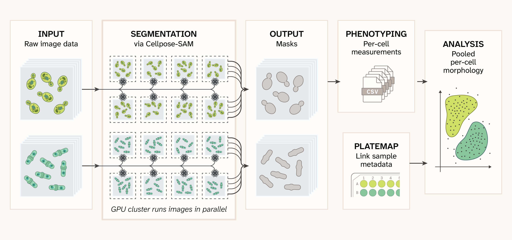

# Scaling single-cell phenotyping with Cellpose and cloud GPU compute

This code repository contains or points to all materials required for creating and hosting the publication entitled, *"Scaling single-cell phenotyping with Cellpose and cloud GPU compute"*.

The publication is hosted at [this URL](https://arcadia-science.github.io/cloud-scaled-cell-phenotyping/).



## Data Description

A two-species yeast panel of brightfield ND2 images: diploid *S. cerevisiae* BY4743 and *S. pombe* SP286, imaged across 16 wells of a 384-well plate (2×2 fields per well; 64 fields of view). The public archive ([10.5281/zenodo.23377605](https://doi.org/10.5281/zenodo.23377605); 764 MB compressed, 2.3 GB unpacked) contains the raw ND2s and precomputed `derived/` artifacts.

Without Modal + S3 access, the notebook downloads and extracts that archive into `datasets/<id>/` on the first local run. If the automatic Zenodo fetch errors or times out, download `<id>.zip` from the record into the same directory and re-run the cell; that bypasses the automatic download. For this pub, `<id>` is `20260611_141152_330`:

```
datasets/20260611_141152_330/
├── raw/                  # brightfield ND2s
└── derived/
    ├── masks/            # label TIFFs
    ├── overlays/         # outline JPEGs
    └── measurements/     # per-cell CSVs
```

## Reproduce

The publication is a Jupyter notebook (`index.ipynb`) rendered with Quarto. The hosted page is that notebook's executed output, so reproducing the pub means executing the notebook. Instructions for doing so, including environment setup, backend choice (Modal + S3 vs local CPU), and the `make execute` / `make preview` commands are available in [SETUP.qmd](pages/SETUP.qmd).

## Contribute

Please see [CONTRIBUTING.qmd](pages/CONTRIBUTING.qmd).
